# **2-Ring CROW 결합 분석 및 Flat-top 필터 설계**

두 개의 마이크로링을 직렬로 결합한 2차 CROW(Coupled-Resonator Optical Waveguide) add-drop 필터를 Tidy3D 3D FDTD로 시뮬레이션하고, 링–링 gap에 따른 **모드 분할(supermode splitting)**, **결합계수 추출**, **TMM 모델 피팅**을 통해 평탄한 통과대역(flat-top)을 만드는 설계 조건을 찾은 프로젝트입니다.

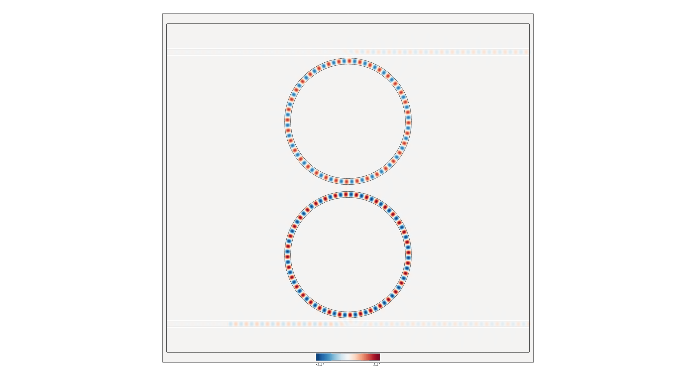

*Re{Hz} at λ = 1549.4 nm (upper 3 dB band edge), ring–ring gap 0.45 μm. 입력(왼쪽 아래) → 아래 링 → 위 링 → drop(오른쪽 위)으로 빛이 전달됩니다. 대역 경계 파장이라 두 링 모두 여기되지만 아래 링이 더 강합니다.*

### 요약

- 링–링 gap 0.2 μm에서 공진이 두 개의 피크로 분할되는 것을 관찰하고, 분할 폭으로부터 링–링 결합계수 $\kappa_{rr}\approx 0.20$을 추출했습니다.
- 링–링 gap을 0.2 → 0.45 μm로 sweep하면서 리플이 4.38 → 1.23 dB로 줄어드는 것을 확인했습니다(격자 20 기준, 0.35~0.45 μm).
- 2-ring CROW 해석식(TMM)을 세 gap의 FDTD drop 스펙트럼에 동시 피팅했습니다(RMS 0.27 dB).
- 피팅으로 얻은 $\kappa_{rr}(\text{gap})$ 지수식을 gap 0.2 μm로 외삽한 값(0.196)이, 독립적으로 분할 폭에서 구한 값(0.195~0.202)과 3% 이내로 일치했습니다.
- 모델로 리플이 사라지는 flat-top 조건을 **gap ≈ 0.53 μm**로 예측했습니다. 이때 3 dB 대역폭은 약 32 GHz로, 넓은 대역의 flat-top을 위해서는 버스 결합도 함께 키워야 한다는 설계 방향을 얻었습니다.

---

# **1. 구조 및 스펙**

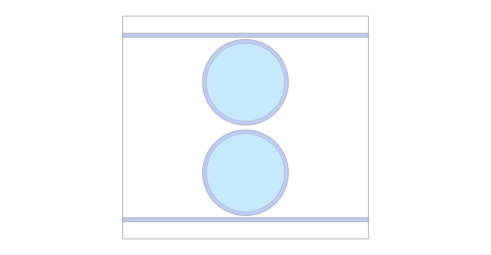

| 항목 | 값 |
|---|---|
| 링 반지름 (도파로 중심선) | 4.0 μm (outer 4.2, inner 3.8) |
| 도파로 폭 / 두께 | 0.4 μm / 0.22 μm |
| Si 굴절률 | 3.47 |
| 링–버스 gap | 0.2 μm (고정) |
| 링–링 gap | 0.2 ~ 0.6 μm (sweep) |
| 포트 | 왼쪽 아래 input, 오른쪽 아래 through, 오른쪽 위 drop |

두 링은 결합할 때마다 회전 방향이 반대가 됩니다(아래 링 반시계, 위 링 시계 방향). 따라서 링이 짝수 개(N = 2)인 CROW에서는 drop 출력이 입력과 **같은 방향**으로 나옵니다.

# **2. 이론**

## 2-1. 결합된 두 링의 모드 분할

동일한 두 링이 결합하면 각 링의 공진이 대칭/반대칭 supermode 두 개로 갈라집니다. 링–링 field 결합계수를 $\kappa_{rr}$라 하면 분할 폭은 근사적으로

$$\Delta\lambda_{\text{split}} \approx \frac{\text{FSR}}{\pi}\,\kappa_{rr}$$

이며, 단일 링의 FSR은

$$\text{FSR} = \frac{\lambda^2}{n_g L},\qquad L = 2\pi R$$

입니다. 이 근사는 분할이 링 선폭보다 충분히 클 때만 성립합니다. 분할이 약해지면 버스 결합에 의해 두 피크가 끌려와 실제보다 좁게 보입니다.

## 2-2. 2-ring CROW 전달함수 (TMM)

링 한 바퀴의 전달을 $r = a\,e^{-j\phi}$, 각 결합기를 $t_i^2+\kappa_i^2=1$로 두고 신호흐름 그래프(Mason 규칙)로 drop/through 전달함수를 유도했습니다. 결합기 1, 3은 링–버스($\kappa_1=\kappa_3=\kappa_{bus}$), 결합기 2는 링–링($\kappa_2=\kappa_{rr}$)입니다.

$$\Delta = 1 - t_2(t_1+t_3)\,r + t_1 t_3\,r^2$$

$$D = \frac{-j\,\kappa_1\kappa_2\kappa_3\,r}{\Delta},\qquad T = \frac{t_1\Delta - \kappa_1^2 t_2 r\,(1-t_2t_3r) + \kappa_1^2\kappa_2^2 t_3 r^2}{\Delta}$$

$$\phi(\lambda) = 2\pi n_g L\left(\frac{1}{\lambda}-\frac{1}{\lambda_0}\right)$$

## 2-3. Maximally-flat 조건

Little 등(1997)의 2차 필터 근사에 따르면, 통과대역이 가장 평탄해지는 조건은 power 결합계수로

$$\kappa_{rr}^2 \approx \frac{1}{4}\left(\kappa_{bus}^2\right)^2$$

입니다. 즉 링–링 결합이 링–버스 결합보다 훨씬 약해야 합니다. 링–링 gap과 링–버스 gap이 같으면 링–링 결합이 너무 강해서 통과대역이 두 피크로 갈라집니다.

# **3. 시뮬레이션 세팅**

- **툴**: Tidy3D (GUI), 3D FDTD, 전면 PML
- **소스**: `ModeSource`, GaussianPulse, 1.525 ~ 1.575 μm, mode solver 주파수 점 10개
- **모니터**: through/drop `FluxMonitor`(1001점), 각 링 내부 점 `FieldTimeMonitor`, 주파수 영역 `FieldMonitor`(Hz)
- **격자**: `min_steps_per_wvl` 20 (경향 탐색용 coarse sweep은 15)
- **구조 파라미터화**: 링–링 gap 변경 시 위아래 구조가 대칭으로 함께 움직이도록 GUI 변수로 연결한 뒤 Parameter Sweep을 사용했습니다.

| 변수 | 식 |
|---|---|
| `ring_y` | `ring_radius + waveguide_width/2 + ring_gap/2` |
| `bus_y` | `ring_y + ring_radius + waveguide_width + waveguide_ring_spacing` |
| `y_domain_size` | `2*bus_y + 4` |

링 중심은 $\pm$`ring_y`, 버스·소스·flux 모니터는 $\pm$`bus_y`에 두었습니다.

### 진행 중 겪은 문제와 해결

1. **필드 모니터 용량 6 GB**: 필드 모니터가 6개 성분 × 128개 파장 × 전체 평면을 저장하고 있었습니다. Hz 하나, 필요한 파장 몇 개로 줄여 수십~100 MB 수준으로 낮췄습니다.
2. **"결합이 안 된다"는 오해**: 처음 필드 그림에서 링 필드가 약해 결합이 안 된 것으로 보였지만, 128개 파장의 간격(약 0.39 nm)이 공진 선폭(0.1~0.3 nm)보다 넓어 공진을 비켜간 것이었습니다. Drop 스펙트럼이 0 dB 근처까지 올라오는 것으로 실제로는 강하게 결합되어 있음을 확인했습니다.

   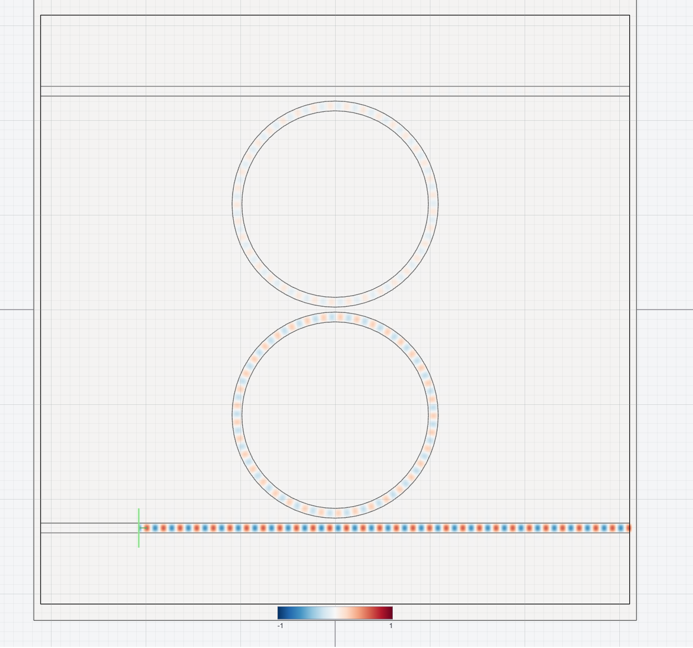
3. **Truncation ringing**: gap이 커질수록(Q가 높아질수록) 공진 사이 바닥에 빠른 진동이 생겼습니다. 링 안의 필드가 다 빠지기 전에 계산이 끝나 생긴 흔적으로 보고, 최종 실행에서는 run_time을 늘렸습니다(약 1.22×10⁶ step, 약 50 ps). 남은 진동은 −40 dB 아래의 수치 바닥으로 통과대역 지표에는 영향이 없습니다.

# **4. 결과**

## 4-1. 링–링 gap 0.2 μm: 모드 분할 관찰 (격자 20)

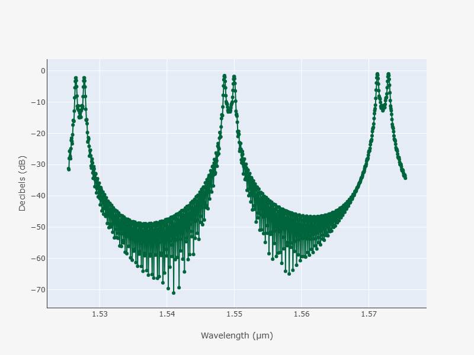
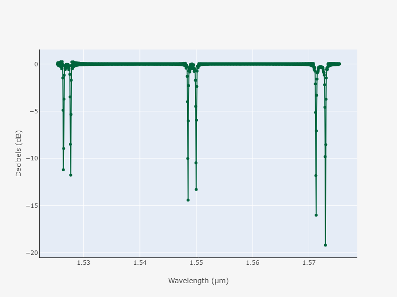

| 공진 | 피크 위치 (μm) | 분할 폭 |
|---|---|---|
| 1 | 1.52647 / 1.52767 | 1.20 nm |
| 2 | 1.54855 / 1.55000 | 1.45 nm |
| 3 | 1.57128 / 1.57293 | 1.65 nm |

- 각 공진이 두 피크로 갈라지고, 두 피크 모두 drop에서 0 dB 근처까지 올라옵니다.
- FSR ≈ 22.5 nm에서 2-1절 식으로 1550 nm 공진의 결합계수를 구하면 $\kappa_{rr} \approx \pi\times1.45/22.5 \approx 0.20$입니다.
- **파장이 길수록 분할이 커집니다.** 긴 파장에서는 모드가 도파로 밖으로 더 퍼져 evanescent 결합이 강해지기 때문입니다.

## 4-2. Coarse sweep (격자 15, gap 0.2 ~ 0.6 μm)

경향을 저렴하게 보기 위해 격자 15로 먼저 sweep했습니다. gap 0.2 μm에서 격자 15의 분할 폭(1.40 nm)은 격자 20(1.45 nm)과 약 3% 차이로, 경향 파악에는 충분했습니다.

| gap (μm) | 1550 nm 근처 응답 |
|---|---|
| 0.2 | 분할 1.40 nm |
| 0.3 | 분할 0.65 nm |
| 0.4 | 하나로 합쳐진 것처럼 보임 |
| 0.5 | 단일 피크, 더 좁아짐 |
| 0.6 | 단일 피크, 피크 −7.2 dB로 낮아짐 |

<details>
<summary>격자 15 sweep drop 스펙트럼 (0.2 → 0.6 μm)</summary>

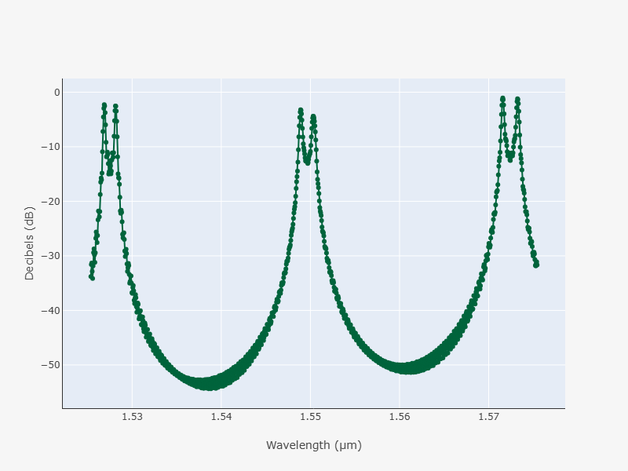
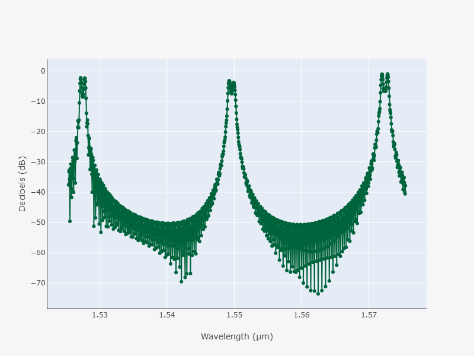
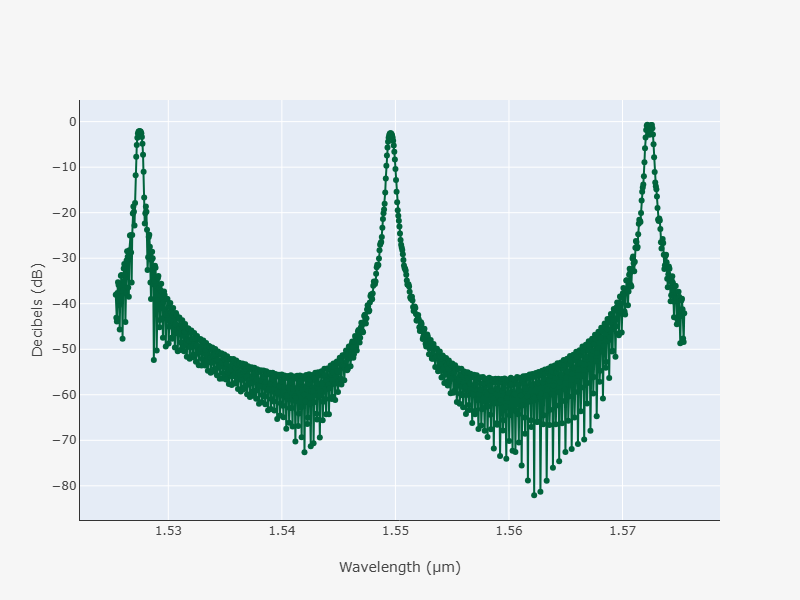
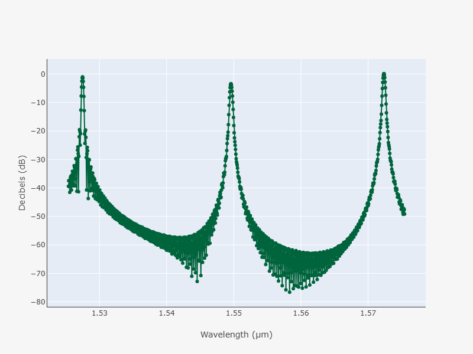
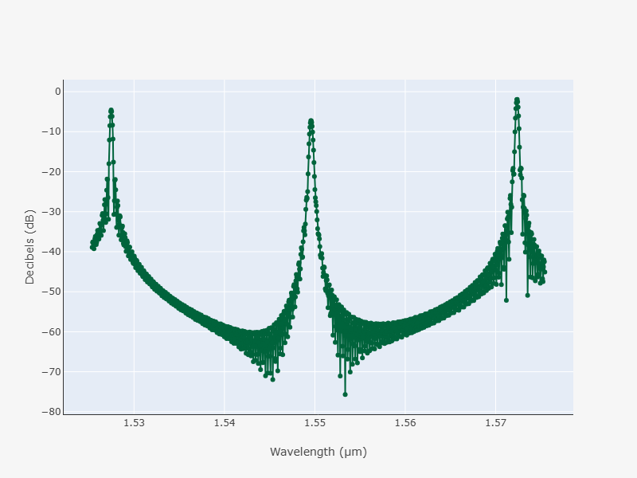

</details>

다만 격자 15에서 0.4 μm가 단일 피크로 보인 것은 짧은 run_time으로 피크가 뭉개진 효과였고, 격자 20·긴 run_time에서는 아직 분할이 남아 있었습니다(4-3절).

## 4-3. 최종 후보 (격자 20, gap 0.35 / 0.40 / 0.45 μm)

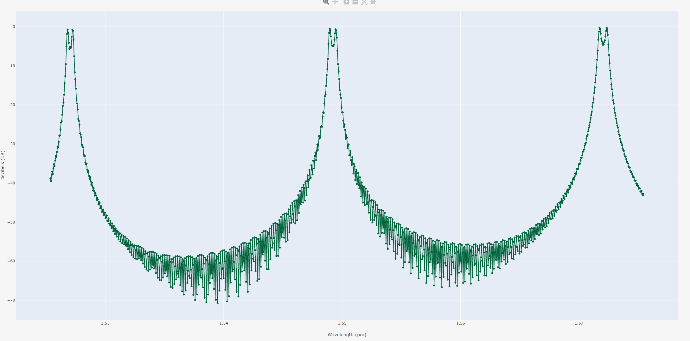
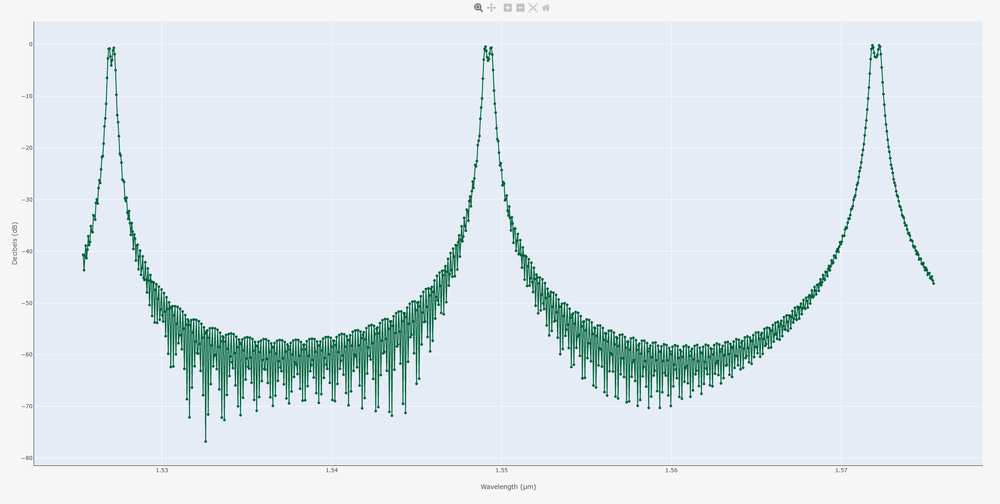
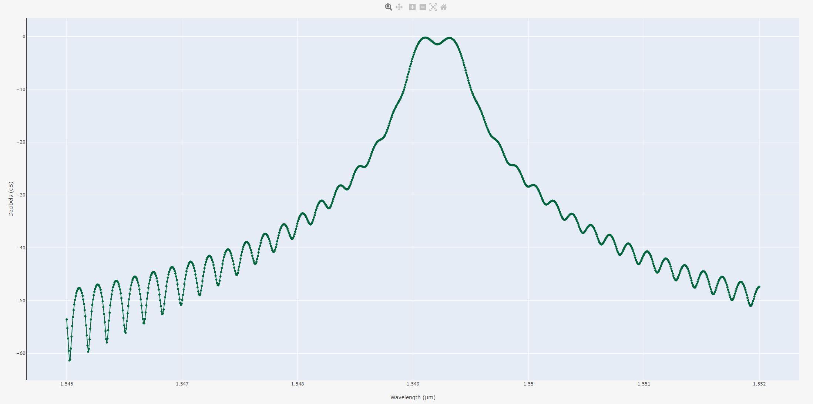

`scripts/export_crow_csv.py`로 결과 hdf5에서 자동 추출한 값입니다([`data/crow_summary.csv`](./data/crow_summary.csv)).

| gap (μm) | 피크 간격 (nm) | 리플 (dB) | 3 dB 대역폭 | 중심 파장 (μm) | 삽입손실 (dB) |
|---|---|---|---|---|---|
| 0.35 | 0.501 | 4.38 | 0.694 nm (≈ 87 GHz) | 1.549216 | 0.47 ~ 0.66 |
| 0.40 | 0.350 | 2.59 | 0.532 nm (≈ 67 GHz) | 1.549212 | 0.44 ~ 0.63 |
| 0.45 | 0.210 | 1.23 | 0.403 nm (≈ 50 GHz) | 1.549211 | 0.22 ~ 0.28 |

- **중심 파장이 5 pm 안에서 고정**: 링–링 결합은 통과대역의 모양만 바꾸고 채널 위치는 거의 바꾸지 않습니다. 대역 모양과 채널 위치를 독립적으로 설계할 수 있다는 뜻입니다.
- **리플과 대역폭의 트레이드오프**: gap이 커지면 리플이 줄지만 3 dB 대역폭도 87 → 50 GHz로 좁아집니다.
- 0.35, 0.40 μm는 파장 간격이 0.05 nm인 넓은 대역 데이터라 피크 꼭대기를 일부 놓쳤을 수 있어, 리플이 약간 작게 측정되었을 가능성이 있습니다.

# **5. 이론 대비 검증**

## 5-1. TMM 피팅

`scripts/fit_crow_tmm.py`로 2-2절 모델을 세 gap의 drop 스펙트럼(1.546~1.552 μm)에 동시 피팅했습니다. 공통 파라미터($\lambda_0$, $a$, $\kappa_{bus}$)와 gap별 $\kappa_{rr}$를 맞추었고, $n_g$는 좁은 창에서 $\kappa$와 구분되지 않으므로 넓은 대역 데이터의 FSR에서 구해 고정했습니다.

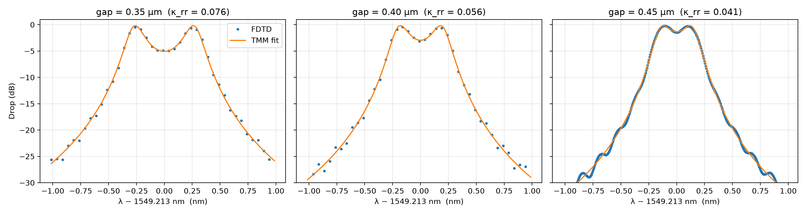

| 파라미터 | 값 |
|---|---|
| RMS 오차 | **0.27 dB** |
| $\lambda_0$ | 1.549213 μm |
| $n_g$ (FSR 22.18 nm) | 4.244 |
| $\kappa_{bus}$ | 0.214 (power 4.6%) |
| 링 손실 $a$ | 0.99949 (약 1.7 dB/cm, 삽입손실 0.19 dB) |
| $\kappa_{rr}$ (0.35 / 0.40 / 0.45 μm) | 0.0764 / 0.0555 / 0.0408 |

$\kappa_{rr}$는 gap에 대해 지수적으로 감소합니다.

$$\kappa_{rr}(\text{gap}) \approx 0.686\,e^{-6.27\,\text{gap}[\mu\text{m}]}$$

gap 0.1 μm당 field 결합은 약 0.53배, power 결합은 약 0.29배로 줄어듭니다.

## 5-2. 교차 검증: gap 0.2 μm 외삽

0.35~0.45 μm 데이터만으로 만든 지수식을 gap 0.2 μm에 넣으면

$$\kappa_{rr}(0.2) = 0.686\,e^{-6.27\times0.2} \approx 0.196$$

이고, 4-1절에서 분할 폭으로 독립적으로 구한 값은 격자 20에서 0.202, 격자 15에서 0.195입니다. **서로 다른 gap 구간과 서로 다른 추출 방법으로 얻은 값이 3% 이내로 일치**하므로, 지수 감쇠 모델이 0.2~0.45 μm 전체에서 성립함을 확인했습니다.

## 5-3. Flat-top 설계점 예측

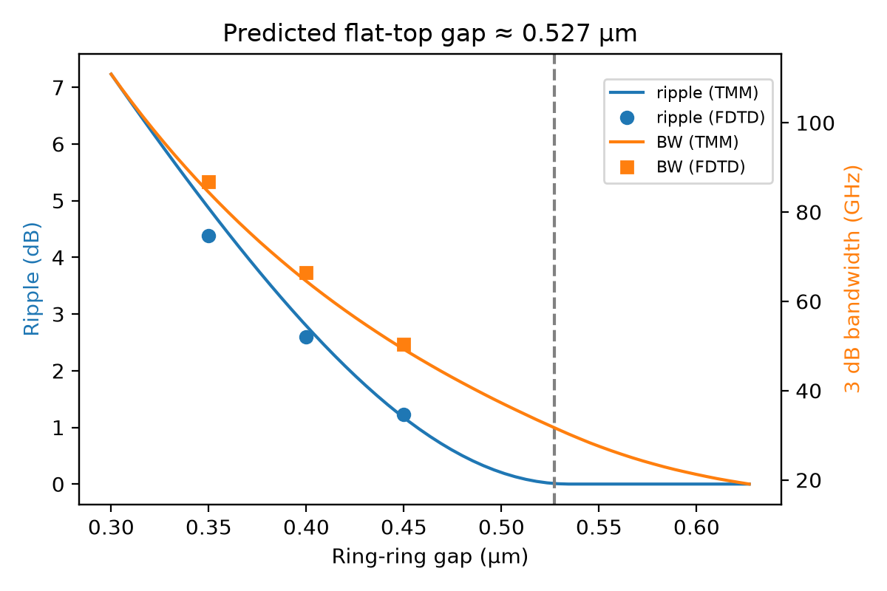

| | 값 |
|---|---|
| 리플이 사라지는 $\kappa_{rr}$ (수치) | 0.0251 (power 0.00063) |
| Little 근사식 $\kappa_{bus}^4/4$ | power 0.00052 |
| **예측 flat-top gap** | **≈ 0.527 μm** |
| 그때의 3 dB 대역폭 / 삽입손실 | 0.254 nm (≈ 32 GHz) / 0.19 dB |

수치 조건과 근사식은 약 20% 차이로, 근사식이 약결합·무손실을 가정한다는 점을 생각하면 일관됩니다.

**설계 시사점**: 현재 버스 결합($\kappa_{bus}^2 = 4.6\%$)으로 maximally-flat을 만들면 대역폭이 약 32 GHz에 그칩니다. 100 GHz 이상의 넓은 flat-top 통과대역이 필요하면 버스 gap을 줄여 $\kappa_{bus}$를 키우고, 이에 맞춰 링–링 결합도 함께 키워야 합니다.

# **6. 한계 및 다음 단계**

- 예측한 flat-top gap(0.527 μm)은 아직 FDTD로 검증하지 않았습니다.
- 모델은 $\kappa$의 파장 의존성(4-1절에서 관찰)과 두 링의 비대칭을 무시합니다.
- 링 손실 값에는 굽힘 복사 손실과 수치 오차가 함께 들어 있습니다.

다음 단계:
1. 목표 대역폭(예: 100 GHz)에 필요한 $(\kappa_{bus}, \kappa_{rr})$ 조합을 TMM으로 계산
2. 로컬 모드 솔버로 gap–κ 관계를 구하고 이번 FDTD 값으로 보정하여 설계 gap 결정
3. PhotonForge의 dual-ring 모델과 비교 후 4채널 CROW WDM demux 및 공정 오차(Monte Carlo) 분석으로 확장
4. 최종 설계만 FDTD로 검증

# **파일 구성**

```
├── README.md
├── figures/               # 레이아웃, 스펙트럼, 필드, 피팅 그림
│   └── sweep_grid15/      # 격자 15 coarse sweep
├── data/
│   └── crow_summary.csv   # gap별 통과대역 지표 (격자 20)
└── scripts/
    ├── export_crow_csv.py # Tidy3D 결과 hdf5 -> CSV + 리플/대역폭 자동 계산
    └── fit_crow_tmm.py    # 2-ring CROW TMM 피팅 및 flat-top gap 예측
```

실행 순서 (결과 hdf5와 같은 폴더에서):

```bash
pip install tidy3d
python scripts/export_crow_csv.py   # data/crow_gap*.csv, data/crow_summary.csv 생성
python scripts/fit_crow_tmm.py      # 피팅 결과와 그림 생성
```

### 참고문헌

- B. E. Little *et al.*, "Microring resonator channel dropping filters," *J. Lightwave Technol.* **15**, 998 (1997).
- A. Yariv *et al.*, "Coupled-resonator optical waveguide: a proposal and analysis," *Opt. Lett.* **24**, 711 (1999).
